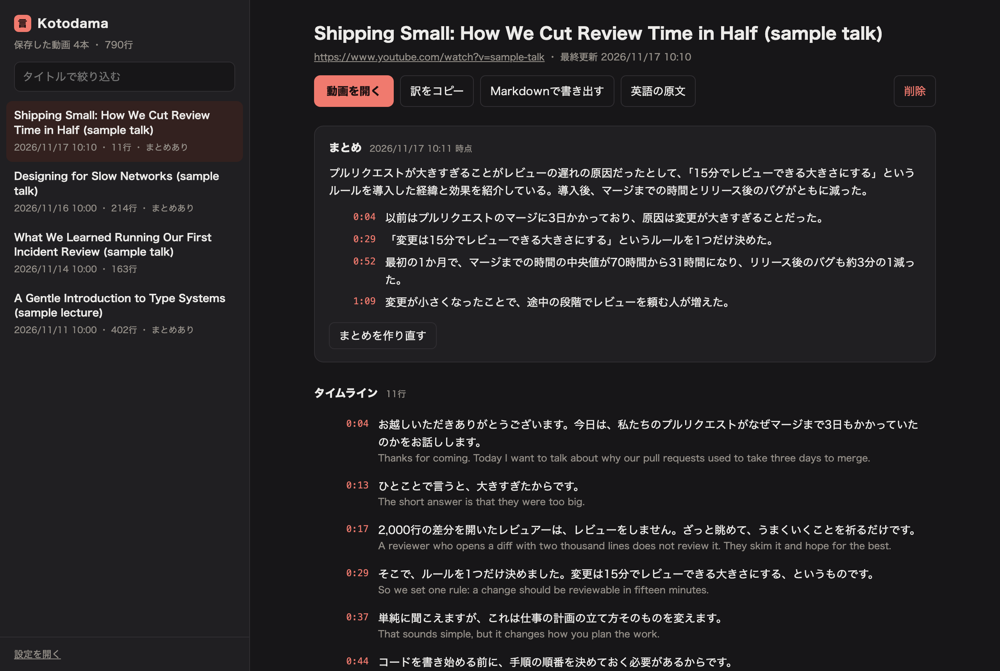
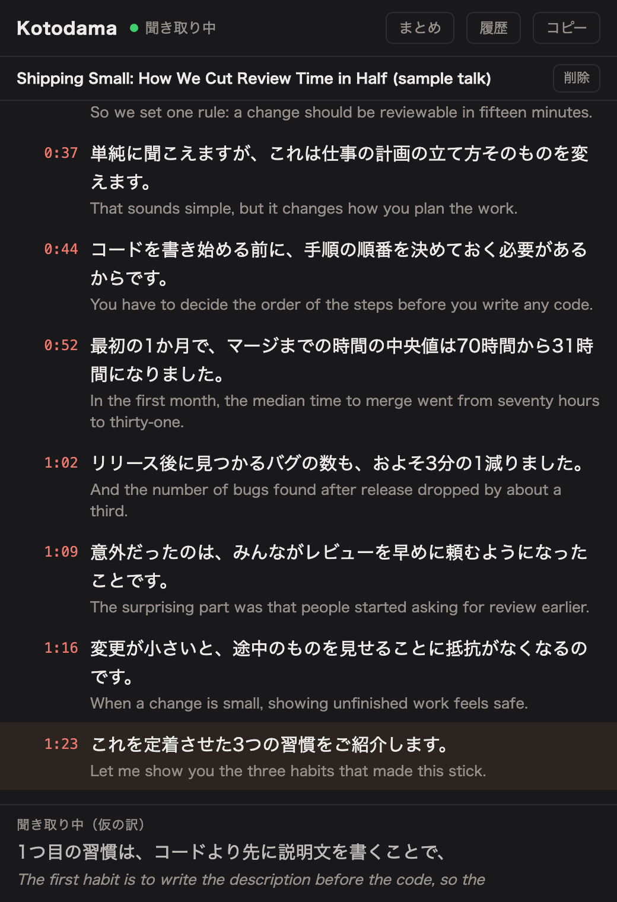
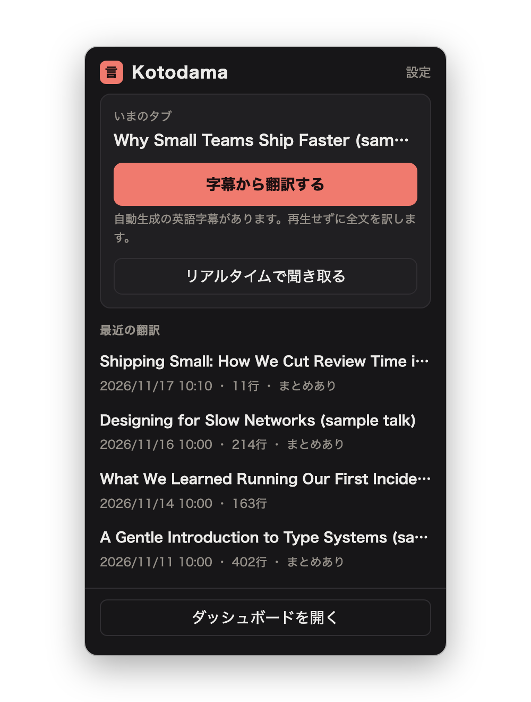

<p align="center"></p>

# Kotodama

[English](README.md)

動画の英語音声を日本語字幕にし、動画ごとに時刻つきのタイムラインとして保存して、まとめも作る Chrome 拡張です。自分の OpenAI APIキーで動かします。



<p align="center">
  
  
</p>

画像の内容は、説明用に作った架空のデータです。

## 2つの翻訳のしかた

| 動画の状態 | 動き | かかる費用 |
| --- | --- | --- |
| 投稿者の日本語字幕がある YouTube 動画 | 字幕をそのまま取り込む（再生不要） | なし |
| 英語字幕がある YouTube 動画（投稿者のもの、または自動生成） | 字幕の全文を取り込み、文単位に直して訳す（再生不要） | 翻訳のみ |
| 字幕がない動画・ライブ配信・YouTube 以外のサイト | 再生しながら音声を聞き取って訳す（リアルタイム翻訳） | 文字起こし＋翻訳 |

YouTube の動画タブでパネルを開くと、字幕がある場合は「字幕から翻訳する」が主ボタンになります。その下の「リアルタイムで聞き取る」で、字幕がある動画でも音声から聞き取れます（自動生成の字幕より認識の精度が高い）。

YouTube が機械翻訳した日本語字幕（自動翻訳）は使いません。細切れの断片ごとの訳で、文として読めないためです。

## 必要なもの

- Chrome 116 以降
- OpenAI の APIキー（利用料は自分の OpenAI アカウントに請求されます）
- ビルド用に Node.js 24 と pnpm 10

## セットアップ

Chrome ウェブストアでは配布していません。ビルドして、パッケージ化されていない拡張機能として読み込みます。

```bash
pnpm install
pnpm build
```

1. Chrome で `chrome://extensions` を開き、「デベロッパー モード」をオンにする
2. 「パッケージ化されていない拡張機能を読み込む」で `dist/` を選ぶ
3. 拡張機能のオプションを開き、OpenAI の APIキーを保存する

コードを変更したら `pnpm build`（または `pnpm watch`）のあと、`chrome://extensions` で再読み込みします。

## 使い方

1. 動画のタブを開き、ツールバーの Kotodama アイコンを押す
2. 開いたパネルで「字幕から翻訳する」（字幕がある YouTube 動画）か、「このタブを翻訳する」／「リアルタイムで聞き取る」を押す（リアルタイム翻訳は、パネルを開かずに Alt+Shift+K でも開始・停止できる）
3. タイムラインのウィンドウが開く。リアルタイム翻訳では、「聞き取り中」と出たら動画を再生する
4. パネルの「翻訳を停止する」を押すか、タイムラインのウィンドウを閉じると停止する

パネルには最近翻訳した動画も並びます。「ダッシュボードを開く」で、保存した動画の一覧と、動画ごとのまとめ・タイムラインを1つの画面で読み返せます。ダッシュボードでは、タイトルでの絞り込み、まとめの作成、訳のコピー、Markdown での書き出し、削除ができます。

音声を取り込めるのは「そのタブの上で拡張を呼び出したとき」だけなので、翻訳の開始はダッシュボードからではなく、動画のタブのパネル（またはショートカット）から行います。

### タイムライン

- 1文ごとに1行で、動画の時刻と訳（と英語の原文）が並びます。時刻を押すと、動画がその位置へ移動します。
- 「コピー」で、時刻と訳をまとめてコピーできます。
- 「まとめ」を押すと、ここまでの内容を、概要と時刻つきの要点にまとめて表示します。「作り直す」で、その時点までの内容で作り直します。
- 再生中は、その位置の行を目立たせて追いかけます（字幕から取り込んだ動画と、聞き取り済みの区間を巻き戻して再生しているとき）。

### 保存と履歴

訳・まとめ・聞き取り済みの区間は、動画ごとに自動で保存します（拡張機能のストレージ。このブラウザの中だけに残ります）。

- 「履歴」を押すと、保存した動画の一覧が出ます。選ぶと、その動画の訳とまとめを読み返せます。
- 過去の動画の時刻を押すと、その位置から新しいタブで開きます（YouTube の場合）。
- 「削除」で、表示している動画の訳とまとめを消します。
- 同じ動画をもう一度開いて開始すると、前回の続きに追記します。聞き取り済みの区間は訳し直しません。

## 設定

| 項目 | 既定値 | 説明 |
| --- | --- | --- |
| 文字起こしモデル | `gpt-live-transcribe` | `gpt-transcribe` にすると安くなるが、区切りまで英語が出ない |
| 仮の訳のモデル | `gpt-6-luna` | 話している途中の訳。約1.2秒おきに呼ぶので、速くて安いモデルにする |
| 確定の訳のモデル | `gpt-6.1-terra` | 文が完結したときの訳。保存されて読み返す文になる |
| まとめのモデル | `gpt-6.1-sol` | 「まとめ」を押したときに1回だけ呼ぶ |
| 区切りの最大秒数 | 8 | 話し続けていても、この秒数で音声を区切る |
| 英語の原文も表示する | オン | |
| 聞き取り中の英語を表示する | オン | |
| 動画の上にも字幕を表示する | オフ | オンにすると、動画の下部にも訳を1文ずつ出す |
| 動画の上の字幕の文字サイズ | 22px | プレイヤーの幅に合わせて拡大・縮小する |

区切りの判定の細かい値（声とみなす音量、区切るまでの無音の長さ）は `src/offscreen.ts` の先頭にあります。

## 費用の目安

2026年11月時点の OpenAI の料金をもとにした見積もりで、計測はしていません。最新の料金は OpenAI の料金ページで確認してください。

- 文字起こし（`gpt-live-transcribe`）: $0.017/分（1時間で約$1）。`gpt-transcribe` は $0.0045/分
- 仮の訳（`gpt-6-luna`）: 話し続けている動画で1時間あたり約$0.2
- 確定の訳（`gpt-6.1-terra`）: 1時間あたり約$0.7
- まとめ（`gpt-6.1-sol`）: 1回あたり数セント
- 字幕からの取り込み: 1時間の動画で$0.1〜0.3程度（翻訳のみ）

## プライバシーとデータの扱い

- APIキー・設定・訳・まとめは、このブラウザの拡張機能のストレージに保存します。下記以外の場所へは送りません。拡張機能を削除すると消えます。
- APIキーは暗号化せずに保存します。自分のパソコンで、自分専用に使う前提です。
- リアルタイム翻訳では、開始したタブの音声を OpenAI の API へ送ります。声が無いあいだや一時停止中は送りません。
- 文字起こしした英文や、取り込んだ字幕の文は、翻訳とまとめのために OpenAI の API へ送ります。
- この拡張機能は自前のサーバーを持たず、利用状況の収集もしません。

## しくみ

### リアルタイム翻訳

```text
パネル / Alt+Shift+K
  └ background（service worker）: tabCapture でタブ音声のストリームIDを取得し、offscreen document を開く
      └ offscreen document
          ├ タブ音声を再生し直す（取り込むとタブが無音になるため）
          ├ AudioWorklet で 24kHz・モノラル・PCM16 に変換（100ms ごと）
          ├ 音量で発話の区切りを判定し、Realtime API（文字起こしセッション）へ送信
          └ 文字起こし結果をためて文の単位に直し、完結した文だけを直前3件を文脈にして翻訳
  └ content script: 訳に動画の再生位置を付け、聞き取り済みの区間を記録する（設定でオンなら動画の上にも字幕を表示）
  └ タイムラインのウィンドウ・ダッシュボード: 保存した記録を読んで表示する
```

- 声が無いあいだは音声を送りません。一時停止中は課金されません。
- 話している途中の内容は、約1.2秒おきに仮の訳としてウィンドウの下端に出ます。文が完結すると、確定した訳が1行追加されます。
- 音声は無音や経過時間で機械的に区切るので、文の途中で切れます。翻訳時に文の単位へ直し、途中の文は続きを待ってから訳します。
- 一度聞き取った区間を巻き戻して再生しても、訳し直しません（その間は音声を送りません）。
- Realtime API のセッションが切れたら自動で張り直します。
- GPT-6 系は推論（reasoning）の既定が「中」で応答が遅くなるので、翻訳では「なし」、まとめでは「低」を指定しています。

### 字幕の取り込み

字幕のURLは、直接取りに行くと空で返ります（認証用の値が要るため）。そこで、ページの中でプレイヤーに目的の字幕を選ばせ、そのときプレイヤーが読み込むURLをそのまま使って取得します（`src/captions.ts`）。取得中は字幕の表示が一瞬切り替わり、終わると元に戻ります。YouTube 側の仕様変更で動かなくなる可能性がある部分です。

取得した全文は、900文字前後の区間に分け、4区間ずつ並行して訳します（`src/import.ts`）。訳せた区間から順にタイムラインへ並びます。

## 開発

```bash
pnpm typecheck   # 型チェック
pnpm build       # dist/ へビルド
pnpm smoke       # ブラウザを使わずに OpenAI との接続を確かめる（macOS。OPENAI_API_KEY が必要）
scripts/screenshots/capture.sh   # README の画像を撮り直す（macOS。Google Chrome が必要）
```

`pnpm smoke` は、macOS の `say` で英語音声を作り、拡張と同じ手順（client secret → WebSocket → 文字起こし → 翻訳）で流します。

```bash
OPENAI_API_KEY=sk-... pnpm smoke
TRANSCRIBE_MODEL=gpt-transcribe OPENAI_API_KEY=sk-... pnpm smoke
```

開発に参加する場合は [CONTRIBUTING.md](CONTRIBUTING.md) を参照してください。脆弱性の報告は [SECURITY.md](SECURITY.md) の手順でお願いします。

## 制限

- 訳せるのは英語の音声・字幕だけで、訳す先は日本語だけです。
- 同時に翻訳できるタブは1つです。
- タブ内で YouTube 以外のサイトへ移動すると、リアルタイム翻訳は自動で止まります。
- YouTube 以外のサイトでは、動画の位置をページ内の `<video>` 要素から読みます。動画が埋め込み枠（iframe）の中にある場合や、音声だけのページでは、動画の位置の代わりに時計の時刻が出て、位置への移動はできません。
- 訳の時刻は、文字数の割合から見積もった目安です。数秒ずれることがあります。
- もう一度訳したいときは、「削除」でその動画の記録を消してから始めます。

## ライセンス

[MIT](LICENSE)。第三者のコードは同梱していません。ビルド時に使うパッケージは [THIRD_PARTY_NOTICES.md](THIRD_PARTY_NOTICES.md) にあります。

Kotodama は非公式のツールです。YouTube は Google LLC の商標です。OpenAI は OpenAI の商標です。各サービスの利用には、それぞれの規約が適用されます。
