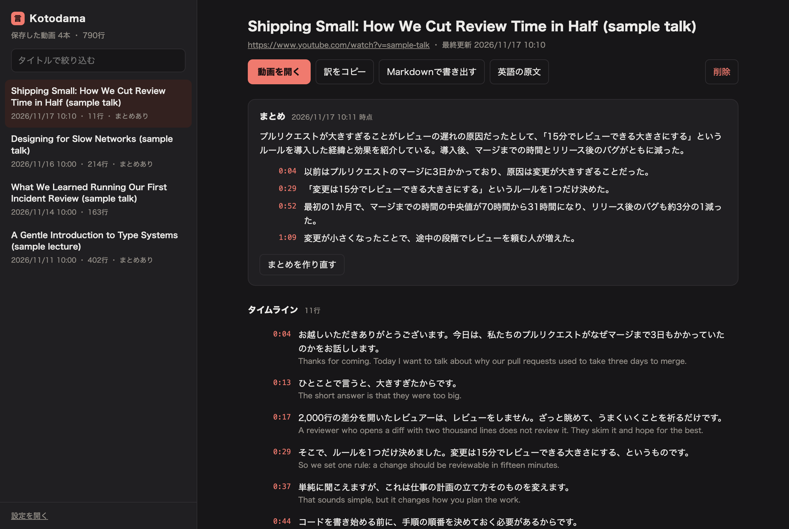
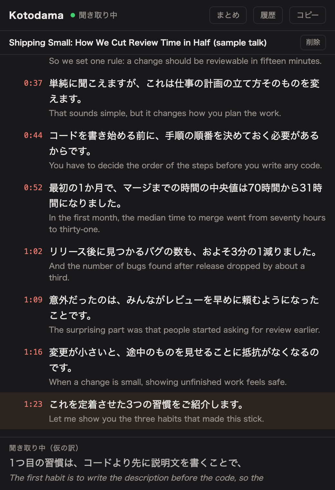
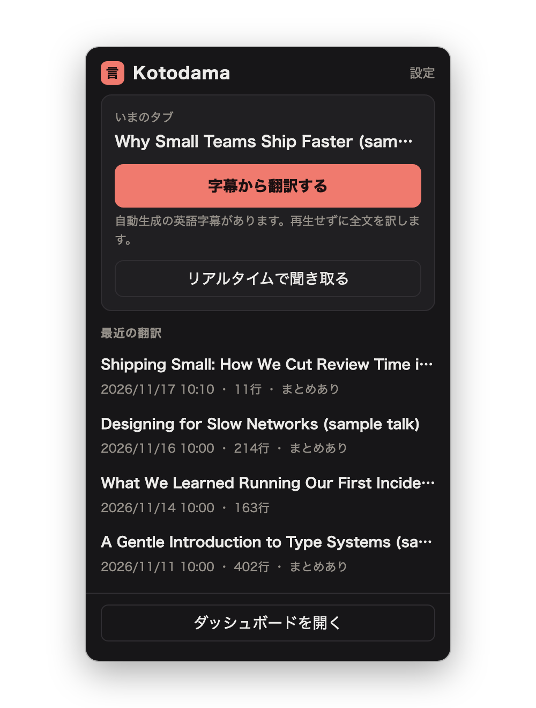

<p align="center"></p>

# Kotodama

[日本語](README.ja.md)

A Chrome extension that turns English video audio into Japanese subtitles, keeps them as a
timestamped timeline per video, and summarizes them. It uses your own OpenAI API key.



<p align="center">
  
  
</p>

The screenshots show made-up sample data.

## What it does

| Video | How it is translated | What you pay for |
| --- | --- | --- |
| YouTube video with Japanese captions uploaded by the creator | Captions are imported as they are, without playing the video | Nothing |
| YouTube video with English captions (uploaded or auto-generated) | The full caption track is imported, re-split into sentences, and translated in one go | Translation only |
| No captions, live streams, or sites other than YouTube | The tab audio is transcribed and translated while the video plays | Transcription and translation |

- **Timeline window**: one row per sentence, with the video time. Click a time to jump there.
- **Live translation**: a draft translation is refreshed about every 1.2 seconds while someone is
  speaking, and replaced by a final translation once the sentence is complete.
- **No repeated work**: parts of a video that were already heard are skipped when you rewind.
- **Summary**: an overview plus key points with timestamps.
- **History**: translations and summaries are saved per video. The dashboard lists them, and can
  search, copy, export to Markdown, and delete.

YouTube's own machine-translated Japanese captions are not used, because they translate short
fragments rather than sentences.

## Requirements

- Chrome 116 or later
- An OpenAI API key (usage is billed to your OpenAI account)
- Node.js 24 and pnpm 10 to build

## Install

There is no Chrome Web Store release. Build it and load it as an unpacked extension.

```bash
pnpm install
pnpm build
```

1. Open `chrome://extensions` and turn on **Developer mode**.
2. Click **Load unpacked** and choose the `dist/` directory.
3. Open the extension's options page and save your OpenAI API key.

After changing the code, run `pnpm build` (or `pnpm watch`) and reload the extension.

## Use

1. Open a video tab and click the Kotodama icon.
2. Click **字幕から翻訳する** (import from captions) when the video has captions, or
   **このタブを翻訳する** / **リアルタイムで聞き取る** (live translation). Live translation can
   also be toggled with `Alt+Shift+K`.
3. The timeline window opens. For live translation, play the video.
4. Close the timeline window, or use the panel, to stop.

The user interface is in Japanese.

## Models and cost

Models are set on the options page. The defaults are:

| Purpose | Default | Notes |
| --- | --- | --- |
| Transcription | `gpt-live-transcribe` | Streams partial text while someone is speaking |
| Draft translation | `gpt-6-luna` | Called about every 1.2 seconds, so a fast and cheap model |
| Final translation | `gpt-6.1-terra` | The text that is saved and read later |
| Summary | `gpt-6.1-sol` | Called once per summary |

Rough estimates, not measured: live translation of a video with continuous speech costs about
US$2 per hour (about half of it transcription). Importing from captions costs about
US$0.10–0.30 for a one-hour video. Check current prices on OpenAI's pricing page.

## Privacy and data

- Your API key, settings, translations, and summaries are stored in the extension's local storage
  in your browser. They are not sent anywhere except as described below. Removing the extension
  deletes them.
- The API key is stored unencrypted. The extension is meant for personal use on your own machine.
- For live translation, the audio of the tab you start it on is sent to the OpenAI API. Audio is
  not sent while nobody is speaking or the video is paused.
- Transcribed or imported caption text is sent to the OpenAI API to be translated and summarized.
- The extension has no server of its own and collects no analytics.

## How it works

```text
Panel (popup) / Alt+Shift+K
  └ background (service worker): gets the tab's audio stream id with tabCapture, opens an offscreen document
      └ offscreen document
          ├ plays the captured audio back, because capturing mutes the tab
          ├ converts audio to 24 kHz mono PCM16 in an AudioWorklet
          ├ detects pauses by volume and sends audio to the Realtime API (transcription session)
          └ buffers the transcript, restores sentence boundaries, and translates complete sentences
  └ content script: attaches the video position to each sentence, and tracks what was already heard
  └ timeline window / dashboard: read the saved records and show them
```

Importing captions (`src/captions.ts`): requesting a caption URL directly returns an empty
response. Instead, a function injected into the page asks the player to select the wanted track
and reuses the URL the player itself requests. This depends on YouTube's player and can break when
YouTube changes it.

## Limitations

- Only English audio and captions are translated, and only into Japanese.
- One tab can be translated at a time.
- On sites other than YouTube, the video position is read from a `<video>` element in the page. If
  the player is inside an iframe, or the page only has audio, rows show the clock time instead and
  jumping to a position does not work.
- Sentence timestamps are estimates and can be off by a few seconds.

## Development

```bash
pnpm typecheck   # TypeScript
pnpm build       # bundle into dist/
pnpm smoke       # check the OpenAI connection without a browser (macOS, needs OPENAI_API_KEY)
scripts/screenshots/capture.sh   # retake the README screenshots (macOS, needs Google Chrome)
```

See [CONTRIBUTING.md](CONTRIBUTING.md). To report a vulnerability, see [SECURITY.md](SECURITY.md).

## License

[MIT](LICENSE). The repository bundles no third-party code; see
[THIRD_PARTY_NOTICES.md](THIRD_PARTY_NOTICES.md) for build-time dependencies.

Kotodama is an unofficial project. YouTube is a trademark of Google LLC. OpenAI is a trademark of
OpenAI. Use of those services is subject to their own terms.
